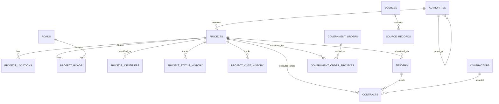

# Database Schema Specification — Telangana Road & Project Intelligence API

**Database Engine**: PostgreSQL 16  
**Spatial Extension**: PostGIS 3.4  
**Primary Spatial SRID**: EPSG:4326 (WGS 84)

---

## 1. Relational ER Diagram

---

## 2. Table Specifications

### `projects`
Stores high-level infrastructure projects across Telangana.
- `id` (SERIAL PRIMARY KEY)
- `project_id` (VARCHAR 255, UNIQUE INDEX)
- `project_name` (VARCHAR 255, INDEX)
- `normalized_project_name` (VARCHAR 255, INDEX)
- `description` (TEXT)
- `category` (VARCHAR 100, INDEX)
- `authority_id` (INTEGER FK → authorities.id)
- `road_id` (INTEGER FK → roads.id)
- `estimated_cost` (DOUBLE PRECISION)
- `awarded_cost` (DOUBLE PRECISION)
- `status` (VARCHAR 100, INDEX)
- `geometry` (GEOMETRY(Geometry, 4326), PostGIS spatial column)
- `geometry_wkt` (TEXT)

### `roads`
Stores road network features and PostGIS geometries.
- `id` (SERIAL PRIMARY KEY)
- `road_name` (VARCHAR 255, INDEX)
- `normalized_road_name` (VARCHAR 255, INDEX)
- `road_number` (VARCHAR 100)
- `road_type` (VARCHAR 100)
- `geometry` (GEOMETRY(Geometry, 4326), PostGIS spatial column)
- `geometry_wkt` (TEXT)

### `project_locations`
Supports one-to-many spatial and administrative locations per project.
- `id` (SERIAL PRIMARY KEY)
- `project_id` (INTEGER FK → projects.id ON DELETE CASCADE)
- `district` (VARCHAR 100, INDEX)
- `municipality` (VARCHAR 100, INDEX)
- `city` (VARCHAR 100, INDEX)
- `latitude` (DOUBLE PRECISION)
- `longitude` (DOUBLE PRECISION)
- `geometry` (GEOMETRY(Geometry, 4326), PostGIS spatial column)
- `geometry_wkt` (TEXT)

### `tenders`
Stores e-Procurement publication notices.
- `id` (SERIAL PRIMARY KEY)
- `tender_id` (VARCHAR 255, INDEX)
- `tender_reference_number` (VARCHAR 255, INDEX)
- `title` (TEXT, INDEX)
- `organisation` (VARCHAR 255)

### `contracts`
Stores awarded contract specifications and values.
- `id` (SERIAL PRIMARY KEY)
- `project_id` (INTEGER FK → projects.id)
- `tender_id` (INTEGER FK → tenders.id)
- `contractor_id` (INTEGER FK → contractors.id)
- `contract_value` (DOUBLE PRECISION)
- `award_date` (TIMESTAMP)

### `contractors`
Stores contractor and bidder registries.
- `id` (SERIAL PRIMARY KEY)
- `legal_name` (VARCHAR 255, INDEX)
- `normalized_name` (VARCHAR 255, INDEX)
- `registration_number` (VARCHAR 100)

### `authorities`
Hierarchical government authority registry.
- `id` (SERIAL PRIMARY KEY)
- `name` (VARCHAR 255, INDEX)
- `parent_authority_id` (INTEGER FK → authorities.id)
- `state` (VARCHAR 100, DEFAULT 'Telangana')

---

## 3. Spatial & Performance Indexes

- B-Tree Indexes on `project_id`, `tender_id`, `tender_reference_number`, `normalized_project_name`, `normalized_name`, `district`, `city`.
- Spatial PostGIS GIST Indexes on `roads.geometry`, `projects.geometry`, and `project_locations.geometry`.
