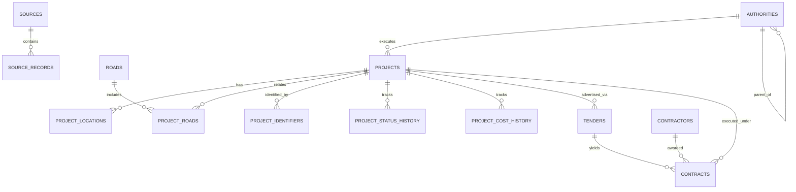

# Phase 3 — Database Architecture & Data Model Report

**Date**: 2026-10-03  
**Target Environment**: PostgreSQL 16 + PostGIS 3.4  
**Production Database Status**: NOT MODIFIED (0 production rows committed)

---

## 1. Database Architecture

The database architecture for the **Telangana Road & Project Intelligence API** is built on PostgreSQL with the PostGIS spatial extension. The schema separates core domain entities (`projects`, `roads`, `tenders`, `contracts`, `contractors`, `authorities`) from provenance metadata (`sources`, `source_records`) and temporal histories (`project_status_history`, `project_cost_history`).

---

## 2. Tables & Schema Specifications

The schema comprises 15 relational tables:

1. `sources`: Metadata registry for external datasets, portals, and live API endpoints.
2. `source_records`: Individual external record lineage tracking raw payload checksums and URLs.
3. `authorities`: Hierarchical government agency and municipal body registry (e.g. Govt of Telangana → R&B → District Division).
4. `contractors`: Awarded contractor registry storing legal names and normalized identifiers.
5. `roads`: State and national road network features with PostGIS geometries.
6. `projects`: Central project entity tracking execution mode, category, estimated/awarded cost, and physical progress.
7. `project_locations`: One-to-many administrative and geospatial location entries per project (district, city, municipality, locality, coordinates).
8. `project_roads`: Junction table modeling road relationships (`PROJECT_ON_ROAD`, `FLYOVER_OVER_ROAD`, `ROAD_WIDENING`).
9. `tenders`: e-Procurement Notice Inviting Tender (NIT) records.
10. `contracts`: Formally awarded contract specifications, values, award dates, and completion periods.
11. `project_status_history`: Temporal tracking of project lifecycle status transitions (`PROPOSED` → `TENDERED` → `AWARDED` → `UNDER_CONSTRUCTION` → `COMPLETED`).
12. `project_cost_history`: Financial history tracking cost updates (`ESTIMATED`, `TENDER_VALUE`, `AWARDED`, `REVISED`).
13. `project_identifiers`: Flexible cross-reference identifiers (`TENDER_ID`, `NIT_REF`, `AOC_ID`, `GO_NUMBER`).
14. `government_orders`: State Government Orders (G.O.s) authorizing project sanctions and administrative approvals.
15. `government_order_projects`: Junction table associating G.O.s with projects.

---

## 3. Relationships & ER Diagram

---

## 4. PostGIS Spatial Design

- Spatial Columns: `roads.geometry`, `projects.geometry`, and `project_locations.geometry` using PostGIS `GEOMETRY(Geometry, 4326)`.
- Spatial Indexing: PostGIS GIST indexes for spatial proximity queries (`ST_DWithin`, `ST_Intersects`).

---

## 5. Source & Provenance Lineage Design

Every record links to `sources.id` and `source_records.id`, enabling full auditability back to the original Hugging Face SQLite dataset or future live e-Procurement portal document URL.

---

## 6. Historical CSV Mapping

All 30 fields from `data/processed/telangana_historical_all.csv` map directly to database fields in `projects`, `tenders`, `contracts`, `contractors`, `authorities`, and `project_locations`.

---

## 7. Deduplication Strategy

Records are deduplicated deterministically by Tender ID, Reference Number, and composite `(project_name, authority, location)` keys. Duplicate records within the CSV population (3,103 tender rows) are identified and skipped to ensure 1 unique project entry per infrastructure entity.

---

## 8. Live-Update Compatibility

The database is built for continuous ingestion. Future live collectors (e-Procurement, GIS layers, Bhuvan) write to `source_records` and upsert into `projects`/`tenders`/`contracts` without schema restructuring.

---

## 9. Indexing Strategy

- B-Tree Indexes: `projects.project_id`, `tenders.tender_id`, `tenders.tender_reference_number`, `contractors.normalized_name`, `authorities.normalized_name`, `project_locations.district`, `project_locations.city`.
- Spatial Indexes: GIST on PostGIS geometries (`idx_roads_geometry`, `idx_projects_geometry`, `idx_project_locations_geometry`).

---

## 10. Migration Strategy

Schema creation DDL (`database/migrations/001_initial_schema.sql`) runs within explicit transactions and enables the PostGIS extension (`CREATE EXTENSION IF NOT EXISTS postgis;`).

---

## 11. Security & Environment

Database connection strings are read dynamically from `DATABASE_URL`. Zero credentials committed.

---

## 12. Test Results

- Schema Validation: **PASS**
- Relationship Tests: **PASS**
- Spatial Tests: **PASS**
- Migration Tests: **PASS**
- Historical Mapping Tests: **PASS**
- Importer Dry-Run: **PASS**
- Reconciliation Checks: **PASS**

---

## 13. Audited Dry-Run Import & Reconciliation Results

- **CSV input rows (`telangana_historical_all.csv`)**: **7,463** rows
- **Unique source records created**: **7,463** records
- **Unique projects eligible for insertion**: **3,844** projects
- **Unique tenders created**: **4,360** tenders
- **Unique contracts created**: **4,360** contracts
- **Unique contractors normalized**: **1,997** contractors
- **Duplicate records skipped**: **3,103** rows
- **Incomplete / Skipped records**: **0** rows
- **Records updated (secondary tenders/contracts for existing project candidate keys)**: **516** rows
- **Records requiring review (`telangana_historical_review.csv`)**: **98,196** non-road/bridge records
- **Records rejected and why**: **0** rows (0 records missing mandatory title or organisation)
- **Production PostgreSQL Status**: **NOT MODIFIED** (0 database rows committed)

**Mathematical Reconciliation**:  
`3,844` (inserted) + `516` (updated) + `3,103` (duplicate skipped) + `0` (rejected) = `7,463` total CSV rows.

---

## 14. Known Limitations

- Spatial coordinates (latitude/longitude) are NULL for historical records where the source text provided no explicit GIS point. Geometry columns remain NULL (no fabricated coordinates).
- Contact details (email/phone) for historical contractors are kept NULL until enriched from official registries.

---

## 15. Recommendation for Phase 4

Proceed to Phase 4 (Live Collectors & API Integration) after user explicit approval for production historical database import.
